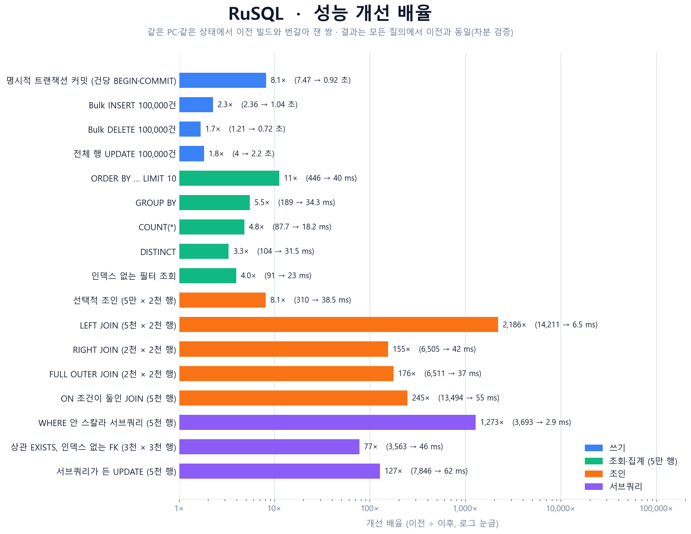

# RuSQL — 2학기 성과 요약 (발표용)

> 상세한 날짜별 기록은 `DATE.md`, 기능 목록은 `FUNCTIONS.md`, 설계 계획과 알려진 한계는 `PLAN.md`에 있습니다.
> 이 문서는 그 가운데 발표에서 말할 것만 한 장으로 줄인 것입니다. 수치의 측정 조건은 `DATE.md` 10월 2일·3일 항목에 있습니다.

## 한눈에

| | |
|---|---|
| 무엇 | MySQL 호환 프로토콜을 쓰는 **자체 RDBMS 엔진**(C++20) + 데스크톱 클라이언트(Tauri/React) + Claude 연동(MCP) |
| 1학기 → 2학기 | Rust 프로토타입 → **C++ 전면 재작성**, "기능 추가"에서 **정합성·동시성·성능을 실제로 파고드는 심화**로 |
| 규모 | 테스트 **860 케이스 / 1,511,281 assertions** (2학기 초 218 케이스 / 3,080 assertions) |
| 엔진 구성 | 파서 → 비용 기반 플래너 → 실행기, MVCC·행 단위 락·데드락 감지, redo 로그 기반 내구성, B+Tree·해시·복합 인덱스 |

## 2학기에 만든 것 (엔진)

- **진짜 MVCC**: 버전 체인(`_xmin`/`_xmax`), 격리 수준 4단계가 실제로 다르게 동작, Gap Lock·SSI.
- **행 단위 동시 쓰기 + 블로킹 락 + 데드락 감지**.
- **내구성**: autocommit도 응답 전에 fsync(redo 로그), 크래시 후 재생. 테이블 파일은 체크포인트에서만 다시 씀.
- **쿼리 엔진**: 조인 알고리즘 5종(중첩 루프·해시·정렬 병합·인덱스 NL·역방향 인덱스 NL)과 비용 기반 선택, CTE(재귀 포함), 윈도우 함수, 서브쿼리, 파티셔닝, 저장 프로시저·트리거. 지원하는 SQL 문법 전체는 `SQL.md`에 한 줄씩 정리되어 있다.
- **운영 기능**: `KILL [QUERY] n`(실행 중인 SELECT·락 대기를 멈추거나 세션을 끊음), `SHOW STATUS`(문장 종류별 수·연결·버퍼 풀·redo·락 대기의 실제 카운터, 데이터베이스 락 없이 읽음), `EXPLAIN ANALYZE`가 조인마다 알고리즘을, 하위 질의는 실행 수와 시간을 따로 보여 줌, **느린 쿼리 로그**(`SET GLOBAL slow_query_log` / `long_query_time`, `Slow_queries`, `information_schema.slow_log`와 MySQL 모양의 `slow_query.log`)와 `innodb_trx`가 트랜잭션을 연 세션을 말함, `GROUP BY … WITH ROLLUP`, 서버가 `8.4.9`라고 말함.

## 2학기에 만든 것 (앱·연동)

- **데스크톱 앱(Tauri/React)**: 홈 화면(연결 카드, 검색, 즐겨찾기·최근 연결), SQL 에디터(스키마를 아는 자동완성, `EXPLAIN` 계획을 상자와 화살표로 그린 그림과 `EXPLAIN ANALYZE`의 단계별 시간 막대, 결과를 JSON으로 내보내기와 막대·꺾은선·파이 차트, 두 데이터베이스의 스키마 비교와 마이그레이션 SQL, 문장 하나가 지나는 단계를 재생하는 Journey), ERD 편집기(외래키 관계를 DDL 미리보기와 함께 편집, 열을 끌어서 연결), 서버 매니저(세션·트랜잭션·락 실시간 패널: KILL 버튼, 다른 트랜잭션을 막는 세션과 오래 도는 문장 강조, 느린 쿼리 로그 켜기와 목록, 크래시 복구에 걸린 시간과 되살린 변경 수를 보여 주는 복구 카드, 초당 문장 수·세션·락 대기·redo 크기·버퍼 풀의 추세 그래프를 그리는 Metrics 패널).
- **보여 주기 위한 페이지**: Diagram(전체 구조), **B+Tree 애니메이션**(키가 들어가며 노드가 쪼개지고 트리가 자라는 모습이 스스로 재생됨), **MVCC 시뮬레이션**(UPDATE가 새 버전을 만들고 세션마다 다른 버전이 보이는 짧은 이야기가 스스로 재생됨; 엔진의 실제 버전은 `information_schema.row_versions`), MySQL 호환성(진짜 MySQL과 코퍼스별 일치율).
- **Claude 연동(MCP)**: 32개 도구. `run_script`는 영향받는 행을 미리 보여 주고 확인한 뒤에만 커밋, `suggest_indexes`는 문장과 통계를 읽고(하위 질의·CTE·OR도) `CREATE INDEX`를 제안(기본은 만들지 않고, `verify`는 임시로 만들어 전·후 `EXPLAIN ANALYZE`를 재고 지움), `health_report`는 "서버 상태 어때?"에 한 번에 답하고(연결·문장·락·교착·복구와 주의할 점), `list_locks`·`trace_query`·`get_table_stats`·`get_fk_graph`는 락 대기, 문장의 단계별 시간, 열 통계, 조인 경로를 JSON으로 준다.

## 성능: 같은 결과를 더 빨리



- 방침: **MySQL을 따라잡는 것이 아니라 RuSQL 자신의 병목을 측정해서 고친다.** 매번 "측정 → 원인 → 수정 → 이전 빌드와 번갈아 재측정" 순서.
- 가장 큰 개선은 **이차 시간 절벽 제거**(LEFT/RIGHT/FULL JOIN, 상관 서브쿼리, WHERE 안 서브쿼리): 행이 늘면 시간이 제곱으로 늘던 문장이 선형이 됨.
- 구조적 원인은 대부분 같았음 — 행 하나가 해시 맵이라 **복사·재파싱이 비용을 지배**. 해법도 같았음: 포인터로 읽기, 필요할 때만 복사, 해시로 후보 좁히기.
- 바뀌지 않은 것: 단건 쓰기 속도는 디스크 fsync가 바닥(MySQL과 같은 내구성 조건에서 같은 값).

## 어떻게 "맞다"고 확신하는가

성능 작업의 위험은 결과가 틀어지는 것이므로 검증에 가장 많이 투자했습니다.

1. **빌드 간 차분 검증** (`code/test/diff/diff_builds.py`): 이전 빌드와 새 빌드에 같은 무작위 SQL(합계 4만 개 이상)을 보내 출력을 글자 단위로 비교.
2. **쌍둥이 질의 대조**: 같은 질의를 "최적화 경로를 못 타게 바꾼" 형태(`… OR 1 = 0`)로 다시 써서 느린 경로와 답이 같은지 확인.
3. **일부러 버그를 심어 보기(mutation)**: 테스트가 정말 잡아내는지 라운드마다 수십 종(최근 타입 인식 비교는 97종)을 심어 확인. 이 과정에서 "0 차이로 통과"가 실제로는 새 경로를 한 번도 안 탄 경우였던 구현 결함을 발견.
4. **크래시 퍼저**: 서버를 `kill -9`로 죽이고 복구한 뒤 확인 가능한 상태와 비교(동시 4개 클라이언트 포함), 복구 뒤 인덱스 질의까지 검사.
5. **무작위 차분 퍼저**: 모든 접근 경로(PK·보조·해시·복합 인덱스)의 답을 같은 질의의 스캔 결과와 대조.
6. Debug·Release, 그리고 모든 DML을 인덱스 경로로 강제한 설정까지 전체 스위트 통과.

## 이 과정에서 찾아 고친 중요한 기존 버그

| 버그 | 영향 |
|---|---|
| 복구 때 **완전히 같은 행이 하나로 합쳐짐** (PK 없는 테이블, 한 트랜잭션) | 크래시 후 **데이터 유실** |
| 세 번째 이후 조인이 앞선 테이블의 열을 이름만으로 읽음 | 208행이어야 할 결과가 **16행** |
| 인덱스가 `.idx` 파일 기준이라 체크포인트 뒤 재시작하면 **빈 인덱스** | 인덱스로 찾으면 0행(스캔은 찾음) |
| 비유일 복합 인덱스가 같은 값의 행 중 **마지막 하나만 기억** | 인덱스 유무에 따라 답이 달라짐 |
| 해시·정렬 병합 조인이 **NULL을 NULL과 매칭** | 조인 결과에 없어야 할 행 |
| PK가 첫 열이 아닌 테이블에서 `WHERE id = N`이 항상 0행 | 오답 |
| `ORDER BY 테이블.열`이 정렬을 안 함 | 조인에서는 알고리즘이 내는 순서 그대로 |
| `SELECT DISTINCT 테이블.열`이 한 행만 돌려줌 | 값이 여러 개여도 1행 |
| 집계 인자의 `테이블.열`에서 테이블이 버려짐(`COUNT(b.id)`) | 두 테이블에 같은 `id`가 있으면 왼쪽 테이블 열을 셈 — `LEFT JOIN`에서 주문 없는 고객도 1로 셈 |
| `HAVING COUNT(열)`이 NULL을 세지 않고 행 수를 돌려줌 | 주문 없는 고객을 `HAVING COUNT(o.id) = 0`으로 못 찾음 |
| select 목록의 식·함수 속 집계(`MAX(v) - MIN(v)`, `ROUND(AVG(v), 2)`, `COALESCE(SUM(v), 0)`)가 0이고 `GROUP BY`가 없으면 테이블 행마다 한 행 | 흔한 집계 식이 전부 오답 |
| NULL이 든 산술·비교·스칼라 함수가 NULL이 아니라 `NULL1`·0·4 같은 값을 돌려주고 `x / 0`이 0, `UPDATE`가 그 값을 저장 | `SET v = v + 1`이 NULL 행에 글자 `NULL1`을 저장 |
| `ROUND(a.x * a.y, 2)`처럼 한정된 열의 식을 함수 인자로 쓰면 곱셈 없이 마지막 열만 읽음 | 조인 질의의 계산 열이 조용히 틀림 |
| 함수 인자 속 별칭이 첫 번째만 테이블로 풀림(`ROUND(y.g * y.g, 2)` → `u.g*y.g`) | 별칭을 쓴 조인에서 같은 이름의 열 계산이 틀림 |
| **빈 문자열 `''`이 NULL로 저장됨**(`IS NULL`·`COALESCE`·UNIQUE도 `''`를 NULL로 취급) | `WHERE s = ''`가 아무 행도 못 찾음 |
| **타입 검사가 없음** — `INT`에 `'abc'`, `DATE`에 `'2024-02-30'`, `VARCHAR(3)`에 `'toolong'`, `DECIMAL(5,2)`에 `123456.789` | 잘못된 값이 그대로 저장되고 이후 계산이 틀어짐 |
| **`UPDATE`가 NOT NULL·자식 쪽 외래 키를 검사하지 않음**, ON UPDATE RESTRICT는 행을 바꾼 뒤 검사 | 제약을 어기는 데이터가 들어가거나, 오류가 났는데 행은 이미 바뀜 |
| **실패한 `REPLACE INTO`가 옛 행을 이미 지움** | NOT NULL 위반 같은 오류가 나면 **행만 사라지는 데이터 유실** |
| `ON DUPLICATE KEY UPDATE`·다중 테이블 UPDATE가 행을 제자리에서 바꿈(되돌리기 기록·제약 검사 없음) | ROLLBACK이 되돌리지 못하고 NOT NULL·UNIQUE·외래 키를 어길 수 있음 |
| NULL과의 `NOT`·`IN`·`NOT IN`·비교가 UNKNOWN이 아니라 TRUE, 서브쿼리가 NULL이면 글자 "NULL"을 0으로 비교, NULL이 정렬에서 글자 | `x NOT IN (1, NULL)`이 행을 골라 냄, `ORDER BY`의 NULL 위치가 값 모양에 따라 흔들림 |
| AUTO_INCREMENT가 직접 넣은 번호를 모르고, 삭제된 부모 행도 외래 키 부모로 인정 | 번호 충돌, 지워진 부모를 가리키는 자식 |
| **같은 테이블을 두 번 쓰는 조인**(`emp e JOIN emp m ON e.mgr = m.id`)이 두 사용을 한 테이블로 봄 | `ann \| ann …`, `ON a.id < b.id`가 0행, LEFT JOIN이 전부 NULL — 직원–상사 같은 흔한 질의가 오답 |
| **`SELECT *`가 조인에서 같은 이름의 열을 왼쪽 값으로** 채움, `*, 열`이 열을 조용히 버림, `DISTINCT *`가 중복을 못 합침 | b.id가 2인데 1이 나옴 |
| `USING`이 조인 종류를 무시(LEFT JOIN … USING이 INNER), NATURAL이 NULL끼리 매칭 | 짝 없는 행이 사라짐 |
| RIGHT/FULL OUTER JOIN이 짝 없는 행의 왼쪽을 첫 왼쪽 행의 키만 보고 채움 | 왼쪽에 행이 없거나 앞선 조인이 있으면 오른쪽 값이 새어 들어감 |
| 한 테이블 UPDATE의 `SET t.v = 1`과 없는 열 `SET zz = 5`가 "1 row(s) updated"인데 행에 보이지 않는 키를 만듦 | 값은 안 바뀌고 이후 읽기가 그 키를 읽음 |
| **존재하지 않는 열 이름이 어디서나 조용히 받아들여짐**(`SELECT nosuch`는 빈 열, `WHERE nosuch > 1`은 0행) | 오타가 "데이터 없음"으로 보임 — 이제 MySQL처럼 `Unknown column` 오류 |
| **프로시저 매개변수·`@변수`가 문장 안에서 값이 아니었음**(`UPDATE … WHERE id = p_id`가 "0 row(s)", `WHERE v > @x`가 0행) | 저장 프로시저가 DML에는 쓸 수 없었음 |
| **트리거가 문장당 한 번, 행 값(`NEW`/`OLD`) 없이** 돌고 본체의 오류를 무시 | 여러 행 INSERT도 한 번, 0행이어도 한 번, 감사 로그를 못 씀 |
| 설정하지 않은 `@변수`를 읽으면 NULL이 아니라 변수 이름 글자 | `SELECT @r`이 `@r` |
| **값이 없는 집계가 NULL이 아니라 0 / 0.0000 / 빈 문자열 / `[]`**(`SUM`·`AVG`·`STDDEV`·`GROUP_CONCAT`·`JSON_AGG`·윈도) | `v IN (SELECT SUM(v) … 빈 집합)`이 `v = 0`인 행을 맞힘, `HAVING AVG(v) < 60`이 값 없는 그룹을 통과 |
| 텍스트 산술: `+`가 글자를 이어 붙이고(`'x' + 1` → `x1`) `- * /`가 숫자 아닌 글자를 통째로 0으로 읽음 | `'12abc' * 2`가 0(MySQL 24), `s - 1`이 0 |
| 소수 합계의 부동소수 오차와 2^53 넘는 정수의 조용한 오차 | `SUM(0.10 × 10)`이 1이 아니라 `HAVING SUM(x) = 1`이 거짓, `n + 1`이 `…992` |
| `AVG`가 select 목록에서는 4자리, `HAVING`/식에서는 전체 정밀도 | 같은 `HAVING AVG(v) = 1.6667`이 select 목록에 `AVG(v)`가 있느냐에 따라 다른 결과 |
| FROM 없는 `SELECT CASE …` / `(SELECT …)` / `COUNT(*)`가 빈 값 | `SELECT (SELECT COUNT(*) FROM t)`가 `''` |
| **`SUM(CASE WHEN …)`·`COUNT(CASE WHEN …)`가 `Unknown column '__case__'`**(앞 항목의 회귀, 푸시된 뒤 발견) | 조건부 집계가 전부 오류 |
| **VARCHAR 열의 비교·정렬·인덱스가 열 타입이 아니라 값의 모양으로 정해짐** — B+Tree 비교기가 이행적이지 않아 숫자처럼 보이는 키와 영숫자 키가 섞인 VARCHAR 키 조회가 누락(344개 중 58개), `ORDER BY code`가 사전식이 아니고 `code = '7'`이 `'007'`도 맞힘 | 키로 찾으면 0행, 정렬·`MIN`/`MAX`·조인이 MySQL과 다름 |
| 우변의 따옴표가 사라져 `WHERE name = 'city'`가 `city` **열**과 비교됨(IN·BETWEEN·변수·엔진이 만드는 조건도) | 값이 열 이름과 같으면 엉뚱한 행이 선택됨 |
| 2^53을 넘는 정수가 비교·정렬·`MIN`/`MAX`·조인 해시에서 같은 수로 취급됨 | `9007199254740993`과 `…992`가 같은 키 |
| **한 select 목록의 조건부 집계 둘이 같은 결과 열 `SUM(CASE)`라 마지막 값이 둘 다로 표시됨**(`SUM(CASE WHEN a > 1 …)`=3이 `SUM(CASE WHEN a > 4 …)`=1로 보임) | 집계표(피벗) 질의가 조용히 틀림 |
| **식의 텍스트가 괄호를 잃음** — 함수 인자 `ROUND((a + b) * 2, 1)`이 `a + (b * 2)`로 계산됨 | 괄호를 쓴 계산이 조용히 틀림 |
| 집계의 인자가 열 이름뿐 — `SUM(price * qty)`·`AVG(a + b)`가 파싱 오류 | 매출 합계 같은 흔한 질의가 실패 |
| **여러 행·여러 열을 돌려주는 스칼라 서브쿼리가 오류 없이 첫 값** — `UPDATE t SET v = 0 WHERE v = (SELECT a FROM u)`가 첫 행의 값이 가리키는 행을 조용히 바꿈 | MySQL은 오류 1242/1241 |
| **서브쿼리 안의 오류가 "행 없음"** — 없는 테이블·안쪽 서브쿼리의 두 행이 `IN`/`EXISTS`는 FALSE, 스칼라는 NULL, `UPDATE`/`DELETE`는 "0 row(s)" | 오류가 어디에도 보이지 않음 |
| **HAVING의 서브쿼리 비교가 늘 FALSE**, **GROUP BY 없는 집계의 HAVING**이 집계 전의 행마다 평가됨(`SELECT SUM(v) FROM t HAVING SUM(v) > 5`가 NULL) | 조건이 늘 거짓이거나 합계가 NULL |
| **`SUM(CASE WHEN …) * 100.0 / COUNT(*)`가 조용히 NULL**(안의 이름이 `AGG(__case__)`), `HAVING SUM(CASE …)`·`SUM(CASE WHEN c THEN a * b END)`는 파싱 오류, `AVG`/`MIN`/`MAX(CASE …)`는 `Unknown column '__case__'` | 비율·점유율 같은 분석 질의가 NULL이거나 실패 |
| **`COUNT(CASE WHEN c THEN 1 ELSE 0 END)`가 모든 행이 아니라 조건이 참인 행만 셈**(MySQL은 NULL이 아닌 값 = 5, 엔진 3), `COUNT(a >= 30)`도 | 조건부 집계의 개수가 틀림 |
| **`CASE … THEN 'n'`·`IF(c, 'n', …)`의 문자열이 같은 이름의 열이 있으면 그 열의 값**(따옴표를 잃은 문자열을 열 이름으로 읽음) | 라벨이 열 값으로 바뀜 |
| **`v BETWEEN w AND 20`이 열 `w`를 문자열 "w"로 비교**, 식 경계(`BETWEEN a AND a + 10`)는 파싱 오류 | 열을 경계로 쓴 범위 조건이 조용히 틀림 |
| **`ROUND(x) * 100`·`COALESCE(a, 0) + COALESCE(b, 0)`·`CAST(v AS SIGNED) + 1`처럼 함수가 식의 처음에 오면 파싱 오류**, 조건이 값이 아니고(`SELECT v BETWEEN 5 AND 20`) 값이 조건이 아님(`WHERE flag`, `WHERE TRUE`), `INSERT … VALUES (1 + 2, UPPER('x'))`·`CURRENT_DATE` 파싱 오류 | 흔한 식이 실패 |
| `NULLIF(5, 5.00)`이 NULL이 아님(글자 비교), **5자리 이상 소수의 합이 4자리로 반올림**(`SUM(price * rate)`), 리터럴 `-0`이 `-0`으로 출력 | 작은 수치 오차·표시 오류 |
| **`CURRENT_DATE`·`SYSDATE()`가 쿼리 캐시에 남음** | 자정이 지나도 어제 날짜 |
| **서브쿼리의 바깥 열이 비교의 왼쪽(`a.id = b.a_id`)·함수·select 목록·HAVING·ON·바깥 별칭에 있으면 모든 행에 참/같은 값**(`DELETE … WHERE EXISTS (… a.id = b.a_id)`가 **전부 삭제**), UNION 서브쿼리는 늘 거짓/NULL | 오류 없이 틀린 답, **데이터 손실** |
| **모호한 열 이름**(`SELECT id FROM a JOIN b …`, `WHERE id = 1`, `ORDER BY id`, `GROUP BY id`)이 오류 없이 첫 테이블 값(MySQL 1052) | 오류 없이 틀린 답 |
| **하위 질의 안의 없는 한정자**(`EXISTS (SELECT 1 FROM b WHERE zz.id = 1)`)가 받아들여져 모든 행에 참 | 오류 없이 틀린 답 |
| **`x IN / NOT IN (빈 서브쿼리)`가 왼쪽이 NULL이면 UNKNOWN**(`NOT IN`은 NULL 행을 빠뜨림, `DELETE … WHERE v NOT IN (빈 서브쿼리)`가 NULL 행을 남김) | 오류 없이 틀린 답 |
| **집계 질의의 `HAVING v > 3`(v는 묶이지 않음)이 0행, `ORDER BY v`는 정렬 없이** | 오류 없이 틀린 답 |
| **별칭을 쓴 `UPDATE a x … WHERE EXISTS (… x.id)`가 모든 행을 바꾸고, `DELETE FROM a x WHERE EXISTS (… x.id …)`가 0행을 지움**, `DELETE x FROM a x JOIN …`이 테이블 없음 | 오류 없이 틀린 갱신·삭제 |
| **`SET @x = (SELECT …)`·프로시저 `SET v = (SELECT …)`가 여러 행/열을 오류 없이 첫 값으로**, 서브쿼리 안의 변수가 풀리지 않고, 프로시저 `WHILE (SELECT … k > i)` 조건의 변수도 | 오류 없이 틀린 답 |
| **`CREATE OR REPLACE VIEW`, `SELECT 1 UNION SELECT 2`, `7 DIV 2`, `1e3`이 파싱 오류** | 요청 거절 |
| **값 자리의 조건이 서브쿼리를 답하지 못하고 거짓**: `CASE WHEN EXISTS (…)`·`IF(x IN (SELECT …), …)`·select 항목 `x IN (SELECT …)`·`JOIN … ON x > (SELECT …)`(조인이 0행), 프로시저의 `WHILE (SELECT …)`·`IF EXISTS` | 오류 없이 틀린 답 |
| **서브쿼리 답의 캐시가 프로시저 반복문에서 묵은 채 남음**(캐시가 노드 주소 열쇠; 반복마다 복사한 문장이 같은 주소에 만들어짐) | 오류 없이 틀린 답 |
| **식 안의 서브쿼리**(`(SELECT …) + 1`, `IN (a, b + 1)`, `LIKE CONCAT(p, '%')`, `UPDATE … SET v = (SELECT …)`, `INSERT … VALUES (…, (SELECT …))`)가 파싱 오류, `INSERT`의 서브쿼리는 열 개수·없는 열 미검사 | 요청 거절 / 틀린 값 |
| **`date`·`year`·`count`·`level`·`user`·`text` 같은 예약어가 아닌 이름의 열을 `CREATE TABLE`이 거절**, **`begin`/`end`라는 열이 서버를 멈추게 함**(문장 분리기가 블록의 시작으로 읽어 응답이 오지 않음)과 프로시저 본문 안의 `CASE … END`가 문장을 자름 | 요청이 거절되거나 서버가 응답하지 않음 |
| **집계 질의의 select 항목**: `SELECT COUNT(*), 1`이 한 열만 돌려주고 `SELECT COUNT(*), v`·`SELECT g, v … GROUP BY g`는 열이 사라지거나 빈 값(MySQL은 오류; 기본키로 묶으면 나머지 열 허용); `TIMESTAMPDIFF(MONTH, …)`가 NULL | 오류 없이 틀린 답 |
| **`MERGE … WHEN MATCHED AND 조건 THEN UPDATE`가 조건을 무시**(모든 매칭 행 갱신)하고 MERGE 조건 안의 서브쿼리는 늘 거짓 | 오류 없이 틀린 갱신 |
| **뷰 조회 결과가 바탕 테이블이 바뀌어도 그대로**(SELECT 결과 캐시가 뷰 이름만 의존), 뷰를 읽는 뷰를 만들 수 없음 | 오래된 답 |
| **`ORDER BY 별칭`이 정렬을 하지 않음** — `SELECT v AS val … ORDER BY val DESC`, `v + w AS k … ORDER BY k`가 테이블 순서 그대로(집계의 별칭만 정렬됨), `ORDER BY 2`·`ORDER BY a + b`·`ORDER BY COUNT(*)`·`GROUP BY 식`은 파싱 오류, UNION의 `ORDER BY 1`·없는 이름도 정렬 안 함 | 오류 없이 틀린 순서 |
| `GROUP BY COALESCE(w, 0)`가 `0.00`과 `0`을 다른 그룹으로(`DISTINCT`도), `COALESCE(code, 'x') = '007'`이 숫자 비교, `SUM(CASE WHEN code = '007' …)`이 `'7'`도 셈(앞 항목의 회귀) | 그룹·중복·조건의 타입 규칙이 틀림 |
| **UPDATE·DELETE의 기본키 단축 경로가 조건을 다시 보지 않음**: `DELETE FROM t WHERE a = b`가 `a = 'b'`인 행을 지움, 텍스트 키의 `WHERE code = 7`이 `'7'`만 처리, 정수 키의 `BETWEEN 5.0 AND 9`가 5번 행을 빠뜨림 | **엉뚱한 행 삭제**·일부 행만 처리 |
| **실제 MySQL 8.4와 같은 문장을 돌려 비교한 점검(10월 12일)**: 모르는 함수가 오류 없이 자기 이름을 글자로 돌려줌, `DATE_ADD`의 월·년 단위와 월말, `CAST(3.9 AS SIGNED)`, `10 / 3 * 3`이 9.999999, 큰 정수가 조용히 double로 | 오류 없이 틀린 답 |
| **복합 `UNIQUE (a, b)`가 첫 열만 지킴**(`CREATE UNIQUE INDEX`·`ALTER … ADD UNIQUE`도), UPDATE·REPLACE·ON DUPLICATE KEY는 아예 안 봄, `ADD UNIQUE`가 이미 있는 중복을 검사하지 않음 | 중복 키가 들어가거나 정상 행이 거절됨 |
| **재시작하면 복합 UNIQUE 키와 파티션 정보가 사라짐**(카탈로그를 읽을 때 열·기본키·CHECK만 복원) — **파티션 테이블은 재시작 뒤 `SELECT`가 0행**, 새 행은 부모 테이블로 | **데이터가 보이지 않음**·제약이 조용히 풀림 |
| DOUBLE/FLOAT 열을 십진수로 계산(`d / 3 * 3` = 3.0001, `STDDEV`가 4자리로 잘림), `ROUND(8 / 59.27, 2)`가 0.14(몫의 4자리를 다시 반올림), DOUBLE의 `ROUND(2.5)`가 3 | 오류 없이 틀린 답 |
| `DROP TABLE`이 외래키로 참조되는 테이블도 지움, `UPDATE`의 `SET a = a + 1, b = a`가 옛 a를 봄, `INSERT INTO t SELECT … FROM t`가 서버를 멈춤(읽기 락을 쥔 채 승격) | 참조 깨짐·오답·멈춤 |
| `START TRANSACTION`, `UPDATE`/`DELETE … ORDER BY … LIMIT`, `SET col = DEFAULT`, `ALTER TABLE … DROP INDEX`, `-2.5e-7`·`3 * -2e2`가 파싱 오류 | 요청 거절 |
| **모든 글자 비교가 바이트 비교**(MySQL 기본 정렬 규칙 `utf8mb4_0900_ai_ci`는 대소문자·악센트를 구분하지 않음): `WHERE name = 'alice'`가 `'Alice'`를 놓침, `GROUP BY`·`DISTINCT`가 대소문자별로 갈라짐, `UNIQUE`·`PRIMARY KEY`가 `'Alice'`와 `'alice'`를 둘 다 받음, `ORDER BY`가 대문자를 모두 앞에, `LIKE 'a%'`가 `'Apple'`을 놓침 | 오류 없이 틀린 답·제약 |
| 정렬 규칙을 따르지 않던 곳(R15 시험이 찾음): 인덱스를 거친 `LIKE 'ab%' ORDER BY id`가 빈 결과, 외래키 `CASCADE`/`SET NULL`이 자식 행을 바이트로 찾아 **고아 행**이 남음, 행 락이 철자 그대로라 `'Bob'`/`'bob'` 동시 INSERT가 둘 다 들어감, 갭 락 범위 판정이 바이트, `RANGE` 파티션의 글자 키가 `'Zed'`/`'zed'`를 갈라 `WHERE name = 'zed'`가 한 행만 돌려줌 | 오류 없이 틀린 답·무결성 |
| **같은 `UNIQUE` 값을 두 세션이 동시에 INSERT하면 둘 다 들어감**(UNIQUE 열·`UNIQUE (a, b)`·복합 기본키·기본키 없는 표; 기본키 열만 클레임이 있었음), UPDATE도 같음 | 중복 키가 조용히 들어감 |
| 행이 무엇이든 기다린 뒤에는 앞서 한 중복 검사가 낡았는데 다시 보지 않음(`AUTO_INCREMENT` 번호 충돌·갭 락 대기 뒤) | 기본키·UNIQUE 중복 |
| **자식 INSERT/UPDATE와 부모 DELETE/UPDATE가 동시에 일어나면 둘 다 성공**(자식이 부모를 확인한 뒤 부모가 지워지고 자식이 쓰임) | **부모 없는 자식(고아 행)**, 시험에서 한 라운드에 200개 안팎 |
| `UPDATE`가 데이터 락을 "자기 표, 이웃 표" 순으로 두 번에 나눠 잡아 다른 문장들의 이름 순서와 어긋남 | 외래키가 얽힌 문장들이 **서로를 기다리며 멈춤** |
| **실제 `mysqldump` 파일을 읽지 못함**(`/*!40101 … */` 실행 주석을 실행하지 않음, `SET` 목록·서버 변수·`FOREIGN_KEY_CHECKS`가 효과 없음, `DEFAULT CURRENT_TIMESTAMP`·표 옵션·`DEFINER=`·뷰의 괄호 조인·`DISABLE KEYS`·`ADD COLUMN … NOT NULL DEFAULT`가 파싱 오류) | 덤프 102문장 중 92문장이 거절되고 **표가 하나도 안 만들어짐** |
| 복합 `FOREIGN KEY (a, b)`가 **첫 열만** 남기고 받아들여지고, MySQL 프로토콜로 돌려준 값에 줄바꿈이 있으면 `\n` 두 글자로, `\|`가 있으면 칸이 쪼개짐 | 외래키가 조용히 약함 / 클라이언트에 틀린 값 |
| **복합 기본키 `(a, b)`의 INSERT가 표에 이미 있는 행을 바이트로 비교**(`('Alice', 1)` 뒤에 `('alice', 1)`이 들어감; R15가 놓침) | 중복 키가 조용히 들어감 |
| **UNIQUE 열·복합 기본키가 있는 표의 여러 행 INSERT가 행마다 표 전체를 훑음**(2만 행: UNIQUE 열 9초, 복합 기본키 23초, 일반 표 0.12초) | 큰 덤프 적재가 몇 분 걸림 |
| **`DROP TABLE`이 표의 색인을 남김**: 같은 이름으로 다시 만든 표가 옛 표의 색인을 통해 읽혀 `WHERE u = 'y'`가 없는 행을 돌려주고(색인 종류마다 같은 행이 겹쳐 나옴), 옛 UNIQUE 값의 INSERT가 중복으로 거절되고, 재시작하면 옛 색인이 되살아남(R20 시험이 찾음) | **틀린 질의 결과 / 거짓 중복** |
| **색인 없는 UNIQUE 열을 바꾸는 여러 행 UPDATE가 바뀐 행마다 표 전체를 훑음**(2만 행 표에서 2000행: 1.3초, 한 번 훑으면 26 ms) | 큰 UPDATE가 느림 |
| **외래키가 있는 자식 표의 INSERT가 문장마다 부모까지 두 표 파일을 다시 쓰고 fsync함**(부모 2만 행에서 한 문장 12.6 ms, 일반 표 0.7 ms) | 자식 표 적재가 18배 느림 |
| **한 행씩 넣는 INSERT가 UNIQUE 열·복합 기본키·`UNIQUE (a, b)`를 찾느라 표 전체를 훑음**(2만 행에서 한 문장 2.0 / 2.0 / 6.9 ms, 일반 표 0.7 ms; `--skip-extended-insert` 덤프가 이 길) | 큰 덤프 적재가 3~10배 느림 |
| **트랜잭션 안에서 지운(또는 키를 옮긴) 행의 UNIQUE 값을 다른 세션이 바로 INSERT할 수 있고, 앞 트랜잭션이 ROLLBACK하면 같은 UNIQUE 값의 행이 둘**(InnoDB는 기다림; R22 시험이 찾음) | UNIQUE 위반이 조용히 생김 |
| **`ROLLBACK`이 외래키 연쇄를 되돌리지 못함**: `ON DELETE CASCADE`로 지워진 자식은 부모가 돌아와도 사라진 채, `SET NULL`은 NULL인 채, `ON UPDATE CASCADE`는 부모에 없는 키를 가리키는 고아 자식을 남김(`ROLLBACK TO SAVEPOINT`도 같음); 이미 시작한 스냅샷이 자식의 제자리 수정을 그대로 봄; 크래시 뒤 redo가 연쇄를 못 다시 만듦 | **외래키 정합성 손상** |
| `ROLLBACK TO SAVEPOINT`가 행을 둘로 만듦: 기본키를 바꾼 `UPDATE`를 되돌릴 때(새 버전을 옛 키로 찾음), 같은 행을 `UPDATE`한 뒤 `DELETE`한 것을 되돌릴 때(두 버전을 다 되살림) | 같은 기본키의 행이 둘 |
| 자식 `UPDATE`·부모 `UPDATE/DELETE`·`REPLACE`·`INSERT IGNORE`·`ON DUPLICATE KEY UPDATE`·`INSERT … SELECT`가 문장마다 표 파일을 다시 쓰는 옛 방식(5~45 ms) | 해당 문장이 느림 |
| **트랜잭션이 열려 있는 동안 표 파일이 쓰이면(체크포인트·다른 세션의 MERGE·DDL·자기 `ROLLBACK TO SAVEPOINT`) 미커밋 행이 파일에 적히고, ROLLBACK 뒤 크래시하면 되돌린 INSERT/UPDATE/DELETE가 되살아남**(외래키 크래시 퍼저 시드 6007이 찾음; 이제 파일에는 커밋된 것만 씀 — `ALTER TABLE`과 버퍼 풀의 flush·교체 경로도 같음) | 크래시 뒤 ROLLBACK한 변경이 보임 |
| **select 항목의 별칭을 `AS` 없이 쓰면 파싱 오류**(`SELECT COUNT(*) c`, `SELECT a x`, `ROW_NUMBER() OVER (…) r`; 진짜 MySQL과 73문장을 비교하다 찾음) | 흔한 SQL 문체가 거절됨 |
| **`INSERT … SET`·`REPLACE … SET`가 없고, 같은 열을 두 번 쓴 INSERT가 받아들여짐**(뒤의 값이 이김; MySQL은 1110 오류) | 흔한 INSERT 문체가 거절되고 잘못된 문장이 조용히 통과함 |
| **`UNSIGNED` 정수 열이 부호 있는 범위로 검사됨**(`INT UNSIGNED`에 `-1`이 들어가고 `4294967295`는 거절, 가장 작은 `BIGINT`도 거절, `2^63` 이상 정수 비교가 double 정밀도) | mysqldump가 쓰는 `unsigned` 열의 값이 틀린 범위로 받아들여짐 |
| **`x = ANY (서브쿼리)`·`x > ALL (서브쿼리)`가 파싱 오류**(진짜 MySQL과 비교하다 찾음) | 표준 SQL 서브쿼리 문체가 거절됨 |
| **행 생성자 `(a, b) IN (SELECT x, y …)`·`(a, b) = (1, 2)`가 파싱 오류**(진짜 MySQL과 비교하다 찾음) | 여러 열 키의 서브쿼리 조회가 거절됨 |
| **`COUNT(DISTINCT a, b)`가 파싱 오류**(진짜 MySQL과 비교하다 찾음) | 여러 열의 서로 다른 값 묶음을 셀 수 없음 |
| **열·표·별칭·색인 이름이 대소문자를 구분**(`SELECT NAME FROM Users`가 열 `name`을 못 찾음; MySQL은 어느 이름도 구분하지 않고 머리글은 쓴 글자 그대로) — 프로시저·트리거·함수·사용자 변수 이름도 | 흔한 SQL 문체가 거절됨(가장 큰 호환 차이) |
| **같은 이름이 두 번 나오는 DDL이 받아들여짐**(`CREATE TABLE t (a INT, A INT)`·`ALTER … ADD COLUMN`으로 이미 있는 열·같은 색인 이름 두 번), select 목록의 같은 이름을 서로 다른 것에 붙이고 `ORDER BY` 하면 모호성 오류 없음 | 잘못된 스키마가 조용히 만들어짐 |
| **`UNION`/`INTERSECT`/`EXCEPT`의 `ORDER BY`가 바이트 비교**(기본 정렬 규칙 무시) | 정렬 순서가 MySQL과 다름 |
| **`CREATE TABLE db.t`·`INSERT INTO db.t`·`DROP TABLE db.t` 등이 파싱 오류**(`db.표`는 FROM에서만 됨) | 다른 데이터베이스의 표를 쓰는 문장이 거절됨 |
| **순서 없는 읽기가 기본키 순서가 아님**(UPDATE한 행이 끝에, 순서 없이 넣은 행이 입력 순서로 나옴; InnoDB는 클러스터드 인덱스 순서) | `SELECT *`·`LIMIT`·`GROUP_CONCAT`·윈도 결과가 MySQL과 다름 |
| **`||`가 문자열 연결**(MySQL 기본은 논리 OR) | `'a' \|\| 'b'`가 MySQL과 다른 값 |
| **값 자리의 행 비교 `SELECT (1, 2) = (1, 2)`가 파싱 오류** | 표준 SQL 행 비교가 select 목록에서 거절됨 |
| **`ALTER TABLE … MODIFY/CHANGE COLUMN`이 그 열의 `UNIQUE KEY`를 지움**(새 정의에 `UNIQUE`가 없다고 열의 플래그를 덮어씀; MySQL에서 UNIQUE KEY는 열 정의와 별개) | 열 타입만 바꿨는데 같은 값이 다시 들어감 |
| **`ALTER TABLE … DROP COLUMN 없는열`·`RENAME COLUMN 없는열`이 오류 없이 성공** | 오타가 조용히 "성공"함(MySQL 1091) |
| **`CREATE TABLE … LIKE`·`AS SELECT`, `RENAME TABLE`, `DROP TABLE a, b`, 쉼표로 이은 여러 동작의 `ALTER TABLE`이 파싱 오류**(진짜 MySQL 클라이언트가 보내는 문장으로 비교하다 찾음) | 도구·ORM이 보내는 흔한 DDL이 거절됨 |
| **`SET autocommit = 0`이 아무 일도 안 함**(모든 문장이 즉시 커밋) | `ROLLBACK`이 아무것도 되돌리지 못함 |
| **`information_schema`에 대한 `COUNT(*)`·집계·조인이 틀림**(0행) | 도구가 표·열 목록을 질의하면 빈 결과 |
| **트리거의 `NEW.col`이 열 타입으로 맞춰지지 않음**(`DECIMAL(10,2)`의 `100 + 1`이 `101`) | 로그 표에 `101` 대신 `101.00`이어야 할 값 |
| **MySQL 프로토콜이 모든 결과 열을 문자열로 보냄**(`pymysql`이 `COUNT(*)`를 `'2'`, 날짜를 `'2024-01-31'`로 받음; 진짜 MySQL은 정수·`Decimal`·`date`) | 파이썬·JDBC 클라이언트에서 숫자 열로 계산·정렬이 안 됨 |
| **DECIMAL 계산·합계·평균이 MySQL과 다른 자릿수로 나옴**(`10.50 * 2`가 `21`, `10 / 4`가 `2.5`, `SUM(price)`가 `35.7500`, `AVG`가 4자리, `ROUND(12.00, 1)`이 `12`; 비교 도구가 숫자를 값으로만 견주어 가려져 있었고 글자까지 견주는 `--exact`로 찾음) | 금액 열의 결과가 `21`·`35.7500`처럼 나와 소수 자릿수가 어긋남 |
| **`SUM`/`AVG`가 FLOAT/DOUBLE·문자열 열도 정확한 십진수로 더함**(MySQL은 DOUBLE로 더해 `0.1 + 0.2` = `0.30000000000000004`) | 같은 데이터의 합계 글자가 MySQL과 다름 |
| **결과 표를 글자로 다시 읽는 경로가 값 양 끝의 공백을 지움**(`INSERT … SELECT`·`CREATE TABLE … AS SELECT`·파생 테이블·CTE·`UNION`·`IN (서브쿼리)`가 `' x '`를 `'x'`로, `'bob '`을 `'bob'`과 같게 봄; MySQL 프로토콜·데스크톱 클라이언트·MCP도 같음) | 문장 하나로 저장된 값이 조용히 바뀜(데이터 손상) |
| **CTE 임시 테이블의 열이 모두 글자 타입**(`WITH c AS (SELECT id FROM t) SELECT id FROM c ORDER BY id`가 `1, 10, 2, 9`(`id`가 1, 2, 9, 10일 때), `MAX(id)`가 `9`; `COALESCE`/`CASE`/`IF`/`CAST`/집계/서브쿼리 열도 같음) | CTE를 거친 정렬·`MAX`·비교가 숫자가 아니라 글자로 됨 |
| **`DATETIME(3)`·`TIMESTAMP(6)`·`TIME(2)`를 받지 못하고, 날짜·시간 값의 소수초를 반올림하지 않고 버림**(`'13:45:10.678'`이 `DATETIME`에서 `13:45:10`; MySQL은 `13:45:11`) | 시각 비교·정렬이 어긋나고 소수초 열이 있는 스키마를 못 읽음 |
| **날짜·시간 값의 흔한 꼴을 거절**(`'20240229134510'`, `20240229`, `'24-02-29'`, `'134510'`, `'1 02'`, 두 자리 `YEAR`) | 다른 도구가 쓴 문장·덤프가 "Incorrect datetime value"로 실패 |
| **`CURRENT_TIME`이 시각이 아니라 날짜를 돌려줌**, `REAL`이 단정밀 `FLOAT`, `DECIMAL`이 `(10,2)` | 값·자릿수가 MySQL과 다름 |
| **`ALTER TABLE … AUTO_INCREMENT = n`이 아무 일도 안 하고**, `information_schema.tables.AUTO_INCREMENT`가 NULL | 다음 번호를 지정할 수 없음 |
| **실제 스키마의 문법을 거절**(`DEC(4,1)`, `DOUBLE PRECISION`, `KEY … USING BTREE COMMENT '…'`, `CHECK … NOT ENFORCED`, `UNSIGNED DECIMAL`, 합성 `INTERVAL` 단위, `CAST AS TIME|YEAR`) | 스키마 한 줄 때문에 파일 전체가 실패 |
| **저장 함수·프로시저의 매개변수·`DECLARE` 변수·`RETURNS`가 타입을 무시**(`DECIMAL(8,2)`에 `1.005`를 주어도, `INT` 변수에 `7 / 2`를 넣어도 글자 그대로 `1.005`·`3.5000`; 인자 수가 달라도 호출됨) | 루틴이 쓰는 값이 MySQL과 달라지고 잘못된 값이 열에 저장됨 |
| **오류로 끝난 `CALL`이 피호출자의 변수를 남겨** 그 뒤 문장의 같은 이름 열을 대신함(`SELECT a FROM t`가 모든 행에서 같은 값) | 한 번의 실패한 호출 뒤 모든 조회가 틀린 답 |
| **0으로 나누기가 `INSERT`·`UPDATE`·저장 함수에서 NULL을 조용히 씀**(MySQL은 오류 1365) | 틀린 값(NULL)이 오류 없이 저장됨 |
| **연결이 `COMMIT`·`ROLLBACK` 없이 끊겨도 열린 트랜잭션이 롤백되지 않음** | 행 락과 커밋되지 않은 버전이 서버가 꺼질 때까지 남아, 그 행을 고치려는 다른 세션이 50초 뒤 락 대기 시간 초과 |
| **`RANGE n PRECEDING`이 값 범위가 아니라 행 수**(10·15·30에서 `RANGE BETWEEN 10 PRECEDING AND CURRENT ROW`가 10·25·55, MySQL은 10·25·30), **행이 없는 프레임이 마지막 행으로 잘려 들어감**(`ROWS BETWEEN 1 FOLLOWING AND 2 FOLLOWING`의 마지막 행이 `COUNT` 1) | 조용히 틀린 이동 합계·평균 |
| **`DATE(x) + 0`이 `2024`, `SUM(날짜 열)`이 `4048`**(MySQL은 20240305, 40480406) | 날짜 함수·합계가 틀린 값을 오류 없이 돌려줌 |
| **FLOAT 0.1 = DOUBLE 0.1이 같다고 나옴**(MySQL은 다름) | 단정밀도 열의 비교가 달라짐 |
| **자기 표를 읽는 하위 질의가 든 `UPDATE`·`DELETE`·`INSERT … VALUES`를 받아들여 실행**(MySQL은 1093), **`ON DUPLICATE KEY UPDATE`의 하위 질의가 현재 데이터베이스를 못 찾음** | 거절해야 할 문장이 실행되거나 멀쩡한 문장이 "Table not found" |
| **윈도 프레임이 ORDER BY에서 같은 값인 행(피어)을 빼고 누적**(`SUM(v) OVER (ORDER BY g)`가 같은 g의 행마다 다름), **그룹·집계 위의 윈도가 빈 값**(`SUM(i) OVER (…) … GROUP BY g, i`), `SELECT DISTINCT … GROUP BY`가 DISTINCT를 무시 | 윈도 누적·순위 보고서와 그룹별 DISTINCT가 조용히 틀림 |
| **`ALTER TABLE … ADD FOREIGN KEY … REFERENCES p (id)`가 부모를 `p`로만 저장**(데이터베이스 없이), 제약 이름은 저장하지 않아 `DROP FOREIGN KEY <이름>`이 듣지 않음 | 그 뒤 자식 표의 **모든 INSERT가 "Referenced table 'p' not found"로 실패**, 이름으로 못 지움 |
| **`ALTER TABLE … MODIFY`가 값은 그대로 두고 정의만 바꾸고**(`'007'`이 `INT` 열에 `007`로 남고, 안 맞는 값도 거절하지 않음), **`ADD`·`DROP`·`MODIFY COLUMN` 뒤 인덱스가 옛 행 사본을 가짐** | 인덱스로 찾은 행이 바뀐 열 정의와 달라 조회가 틀림 |
| **준비된 문장이 따옴표 안의 `?`까지 바꾸고 값을 따옴표 없이 넣음**(`'it''s ok?'`), 인자 수를 검사하지 않음, `EXECUTE` 뒤 `LAST_INSERT_ID()`가 틀림 | 준비된 `INSERT`·`SELECT`가 틀린 값을 쓰거나 읽음 |
| **홀로 있는 `!`를 어휘 분석기가 버림**(`WHERE !(a > 1)`이 `WHERE (a > 1)`) | 거른 행만 남음 |
| **트리거가 쓴 행이 문장의 `LAST_INSERT_ID()`를 바꿈** | 애플리케이션이 받는 번호가 틀림 |
| **`DOUBLE`·`FLOAT` 열이 넣은 글자를 그대로 둠**(`1e10`, `FLOAT`의 15자리 값), **64비트 부호 없는 끝값**(`CAST('18446744073709551616' AS UNSIGNED)`, `~0`)이 마지막 자리에서 어긋남 | 같은 값의 글자·연산 결과가 MySQL과 다름 |
| **프로시저 본문의 `INSERT` 뒤 `LAST_INSERT_ID()`가 앞선 값**(가장 바깥 문장이 `CALL`이라 번호를 기록하지 않음) | 프로시저가 만든 행의 번호를 애플리케이션이 못 받음 |
| **본문이 `SELECT … ; SET …`로 끝나는 `CALL`이 결과 표를 잃음**(마지막 문장의 메시지만 답함) | 프로시저의 조회 결과가 사라짐 |
| **`BEFORE INSERT` 트리거의 `NEW`가 열이 받아들일 값이 아니라 쓴 그대로**(`DECIMAL(8,2)`에 `1.005`를 넣으면 열에는 `1.01`인데 트리거는 `1.005`로 `3 * NEW.price`를 `3.02`로 계산; MySQL `3.03`) | 트리거가 채우는 파생 열이 틀린 값으로 저장됨 |
| **글자를 수로 읽는 산술이 쓰는 문장에서도 조용히 통과**(`INSERT … SELECT s + 1`의 `s`가 `'abc'`·`'12abc'`이면 1·13이 저장됨; MySQL은 오류 1292) | 틀린 값이 오류 없이 저장됨 |
| **어휘 분석기가 `:`를 버려 `SELECT @a := 1`·`SELECT @i := @i + 1`이 비교로 읽혀 조용히 NULL** | 행 번호 매기기 같은 관용구가 NULL을 냄 |
| **BIGINT 최솟값보다 작은 음수를 `UNSIGNED`로 바꾸면 2^64에서 그대로 빼 `1`·`0` 같은 값**(`CAST('-18446744073709551615' AS UNSIGNED)`, `-9223372036854775809 | 0`; MySQL은 `9223372036854775808`) | 비트 연산·형 변환 결과가 틀림 |
| **`INSERT IGNORE`·`ON DUPLICATE KEY UPDATE`로 건너뛴 행이 AUTO_INCREMENT 번호를 가져가고, 실패한 문장은 번호를 모두 돌려놓음**(`INSERT IGNORE … VALUES ('x',50),('y',1),('w',52)`에서 `w`가 5번; MySQL은 4번에 남은 번호를 버림) | 같은 문장이 같은 번호를 매기지 않아 id를 기대하는 곳이 어긋남 |
| **같은 문장 안에서 앞 행과 키가 겹치는 행이 `IGNORE`·`ON DUPLICATE KEY UPDATE`에서도 "Duplicate value" 오류** | 한 문장으로 같은 키를 누적하는 배치(`VALUES ('a',1),('a',1) ON DUPLICATE KEY UPDATE n = n + VALUES(n)`)가 실패 |
| **뷰를 거친 `UPDATE`·`DELETE … ORDER BY`/`LIMIT`가 "Table not found" 오류**(`UPDATE v SET … ORDER BY id DESC LIMIT 1`) | 있는 문법이 뷰에서만 막힘 |
| **`FLOAT` 열을 일곱 자리 넘게 보임**(`1.23456789`가 `1.2345679`·MySQL `1.23457`; `CAST(x AS FLOAT)`는 글자 그대로) | 같은 값이 MySQL과 다르게 보임 |
| **날짜·시간·ENUM·SET 열을 수로 쓰면 글자 앞부분을 수로 읽음**(`d + 0`이 `2024`·MySQL `20240102`, `e + 1`이 1·MySQL 3, `WHERE e = 2`·`d > 20240101`이 행을 못 고름) | 날짜 산술·비교가 틀린 결과 |
| **`UPDATE`·`DELETE`의 `WHERE` 안 0 나누기(`n / b`)와 숫자와 견준 수 아닌 글자(`s = 5`)를 조용히 건너뜀**(MySQL은 문장 전체가 오류 1365·1292) | 잘못된 데이터가 있어도 문장이 "성공"해 다른 DB에서 깨지거나 오류를 놓침 |
| **`UPDATE t SET u = u + 1`처럼 UNIQUE·PRIMARY KEY 값을 한 칸씩 밀면 MySQL은 행마다 검사해 오류(1062)인데 여기는 문장이 끝난 뒤의 값만 봐 통과**(`ORDER BY u DESC`를 붙이면 MySQL도 통과) | 같은 문장이 MySQL에서는 실패하는데 여기서는 성공해 다른 DB로 옮길 때 깨짐 |
| **외래키 연쇄가 표를 건너 한 단계에서 멈춤**(`a ← b ← c`에서 `DELETE FROM a`가 `b`는 지우고 `c`는 두어 매달린 행이 남음, `c`가 RESTRICT여도 통과; 키를 바꾸는 `UPDATE`의 `ON UPDATE CASCADE`도 손자는 옛 값에 남음; MySQL은 사슬 끝까지 가고 아래쪽 RESTRICT는 1451) | 상품–주문–주문항목 같은 흔한 3단계 구조에서 조용히 고아 행이 생김 — 이제 사슬 끝까지, 아래쪽 RESTRICT는 아무것도 바꾸지 않고 거절 |
| **행이 없는 SELECT가 열 이름을 잃음**(엔진이 `0 rows returned.`만 돌려줘 MySQL 프로토콜에서 `cursor.description`이 None; 드라이버·도구가 빈 결과의 열 이름을 못 얻음) | pandas `read_sql`·DBeaver·JDBC 메타데이터가 빈 결과에서 열 이름을 못 얻음 — 이제 머리줄이 있는 빈 표, 프로토콜은 타입이 붙은 열 |
| **`SHOW TABLES LIKE '패턴'`의 열 이름**이 MySQL의 `Tables_in_db (패턴)`과 다름(진짜 MySQL의 빈 결과 열 이름을 비교하다 찾음) | 열 이름으로 읽는 도구에서 차이 |
| **자기 표를 가리키는 외래키(`emp.mgr → emp.id`)의 부모 쪽이 검사되지 않음**(`DELETE FROM emp WHERE id = 1`이 `id = 2`가 가리키는 행을 오류 없이 지우고 CASCADE·SET NULL도 안 함; MySQL은 1451) | 직원–상사·카테고리 트리 같은 흔한 구조에서 매달린 행이 생김 — 이제 InnoDB처럼 행 단위로 처리 |
| **`WITH`(CTE)·파생 표 SELECT·`PREPARE`/`EXECUTE`·`ANALYZE`·`LOCK TABLES`가 쌓인 redo 로그를 체크포인트로 비움**(INSERT 직후 `WITH` SELECT가 13 ms) | 쓰기 사이에 낀 읽기가 redo의 이점(커밋 = 작은 배치 + fsync 1번)을 없앰 — 이제 0.23 ms |
| **`UPDATE`가 같은 값으로 다시 쓴 행도 센다(MySQL은 바뀐 행만), `ON DUPLICATE KEY UPDATE`·`REPLACE`는 삽입한 행 수만 말하고, `DELETE`·`UPDATE`의 `AFTER` 트리거 문장이 바깥 문장의 수를 덮어씀** | `ROW_COUNT()`와 클라이언트의 `rowcount`·`executeUpdate`가 MySQL과 다름 (`CLIENT_FOUND_ROWS`를 켠 Connector/J·MySQLdb는 찾은 행) |
| **`REPLACE`가 사슬 아래에서 막히면 앞 행이 지워진 채 남음**(`t1 ← t2(CASCADE) ← t3(RESTRICT)`에서 `REPLACE INTO t1 VALUES (2), (1)`이 오류로 끝나는데 행 2가 사라짐; MySQL은 아무것도 안 바꿈. UPDATE와 DELETE가 한 문장에 든 MERGE도 같은 구멍) | **데이터 유실** — 이제 지워질 행 전부를 쓰기 전에 사슬 끝까지 모의해서 문장 전체를 거절 |
| **FLOAT 값**(`MIN`·`MAX`·`GREATEST`·`COALESCE`가 6자리가 아닌 저장 글자를 보임, FLOAT를 DOUBLE·글자 열로 복사하면 6자리로 줄거나 짧은 글자가 들어감 — MySQL은 FLOAT를 넓힌 값) | FLOAT 열을 쓰는 보고서·복사한 열의 값이 MySQL과 다름 |
| **한 열에 외래키를 둘 달면 앞의 것이 말없이 사라짐**(`FOREIGN KEY (x) REFERENCES a(id), FOREIGN KEY (x) REFERENCES b(id)`) | 한쪽 부모의 무결성이 검사되지 않음 — 이제 키마다 따로 검사·연쇄·나열 |
| **`a RIGHT JOIN b USING (c)`의 `*` 열 순서**가 MySQL과 다름(MySQL: 합쳐진 열 → b의 나머지 → a의 나머지) | 열 위치로 읽는 클라이언트에 조용한 오답 |
| **`UNION`의 왼쪽이 0행이면 오른쪽 값이 사라짐**(빈 글자 행 하나가 나옴; R53에도 있던 오답) | 왼쪽이 비는 합집합이 통째로 틀림 — 이제 오른쪽 행이 왼쪽의 열 이름 아래에 |
| **`SELECT 'a'`의 머리글**이 `'a'`(MySQL은 `a`), **`SELECT 1 WHERE 1 = 0`**이 문법 오류, USING·NATURAL 조인과 `CALL`의 빈 결과에 열 이름이 없음 | 열 이름으로 읽는 도구, FROM 없는 조건식 |
| **FLOAT가 DOUBLE·정수 열·DECIMAL과 섞인 함수**(`COALESCE(f, d)`의 0.1을 저장된 짧은 글자로 냄 — MySQL은 FLOAT를 넓힌 값 0.10000000149011612), **FLOAT인 함수 결과에 대한 산술·비교**(`GREATEST(f, 0) + 1`이 1.1, `WHERE GREATEST(f, 0) = 0.1`이 1행 — MySQL은 1.1000000014901161과 0행), **윈도 `MIN`·`MAX`·`LAG`·`LEAD` 같은 함수의 FLOAT**(6자리가 아닌 저장 글자) | FLOAT 열을 `COALESCE`·`GREATEST`로 다루는 보고서, 조건의 행 수가 MySQL과 다름 |
| **이어지는 `USING` 조인의 `*` 열 순서**(MySQL `y, x, …`, 여기 `x, y, …`; `USING (y, x)`는 왼쪽 표의 순서) | 열 위치로 읽는 클라이언트에 조용한 오답 |
| **이름 없는 외래키의 자동 이름**이 열 순서로 매겨져 `DROP FOREIGN KEY` 뒤 남은 키의 이름이 바뀜 | 이름으로 키를 지우는 마이그레이션 스크립트가 엉뚱한 키를 가리킴 — 이제 이름을 만들 때 정해 저장하고 ALTER ADD는 가장 큰 번호 + 1, RENAME은 접두사를 바꿈 |
| **`referential_constraints`가 규칙을 안 적은 키를 `RESTRICT`로 말함**(MySQL은 `NO ACTION`, 적은 `RESTRICT`만 `RESTRICT`) | 스키마를 읽어 옮기는 도구가 규칙을 바꿔 적음 |
| **MySQL 프로토콜의 오류가 전부 번호 1064**(중복 키·외래키·모르는 열도) | 드라이버·ORM이 번호로 재시도·중단·변환을 정함 — 이제 약 40종을 MySQL 번호로(코퍼스 전체의 다른 번호 385개 → 약 20개), 빠뜨린 NOT NULL 열은 1364 |
| **`RENAME TABLE` 뒤 `information_schema`가 옛 표 이름을 말함**, **부모 표의 이름을 바꾸면 자식의 외래키가 옛 이름에 매달려 INSERT가 실패함** | 표 이름을 바꾸는 마이그레이션 뒤 앱의 스키마 화면·자식 INSERT가 깨짐 |
| **집계만 있는 한 행짜리 답의 `FOUND_ROWS()`가 0**(`SELECT COUNT(*) FROM t; SELECT FOUND_ROWS()` — MySQL은 1; R37부터 있었음) | 페이지 나누기 쿼리와 느린 쿼리 로그의 보낸 행 수가 틀림 |

성능·정합성 작업의 커밋들에서 찾은 기존 버그는 모두 212건입니다(전체 목록은 `DATE.md`).

## 한계와 앞으로

- 이번 학기 성능 작업은 **의도적으로 여기서 동결**했습니다. 남은 것은 상수 배수 수준(100,000행에서 `ANALYZE`·`INSERT … SELECT`·`UNION ALL`이 1.5~1.7초)이며 `PLAN.md`에 후보로 기록했습니다.
- 쓰는 문장 안의 상관 서브쿼리, `NATURAL`/`USING` 조인은 아직 중첩 루프입니다.
- 설계상 범위 밖: XA 분산 트랜잭션, 페이지 단위 버퍼 풀, WAL 복제.
- 알려진 한계(`PLAN.md`): `SHOW …`·`SELECT @@변수`·저장 함수·준비된 문장의 결과가 MySQL 프로토콜에서 아직 문자열인 것, `AVG`를 식에서 쓸 때 MySQL의 9자리(`AVG(v) * 3` = `5.0000`) 대신 보이는 값으로 이어 계산하는 것, select 안의 대입 `SELECT @x := 식`이 없는 것, 기본키 없는 표의 `UPDATE` 뒤 행 순서와 조인의 둘째 표 이하 순서가 InnoDB와 다른 것, AFTER 트리거 실패가 쓴 행을 되돌리지 않는 것, `ORDER BY`·`GROUP BY` 식·집계 인자 안의 서브쿼리(오류로 거절), 타입을 모르는 식(`COALESCE`·`IF` 결과)·`IN (서브쿼리)`·`UNION`의 `ORDER BY` 같은 몇몇 비교는 예전 규칙, 열 단위 `COLLATE`/`BINARY`가 없는 것(대소문자를 구분하는 열을 만들 수 없음; 파싱 오류로 거절됨), 명령줄 상자 표에서 값 양 끝의 공백이 `\s`로 보이는 것(MySQL 클라이언트에는 프로토콜 계층이 되돌려 줌).
- AI는 사설 모델 대신 **Claude + MCP**로 일원화했습니다(`AI.md`).

## 직접 확인해 보기

```text
# 전체 테스트 (Release)
cmake --build code/build --config Release --target engine_tests
code/build/backend/tests/Release/engine_tests

# 성능 측정 (서버를 7878 포트로 띄운 뒤)
python code/test/perf/bench.py          # 쓰기·트랜잭션·인덱스 조회
python code/test/perf/bench_query.py    # 스캔·집계·조인
python code/test/perf/graph.py          # benchmark_result.png

# 이전 빌드와 결과 비교
python code/test/diff/diff_builds.py <이전 engine_server.exe> <새 engine_server.exe> --queries 1500 --seed 1

# 크래시 복구 검증
python code/test/crash/fuzz_crash.py 60
```
